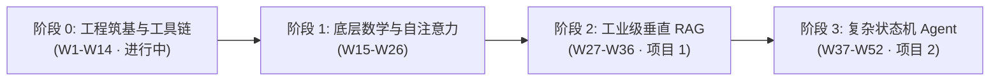
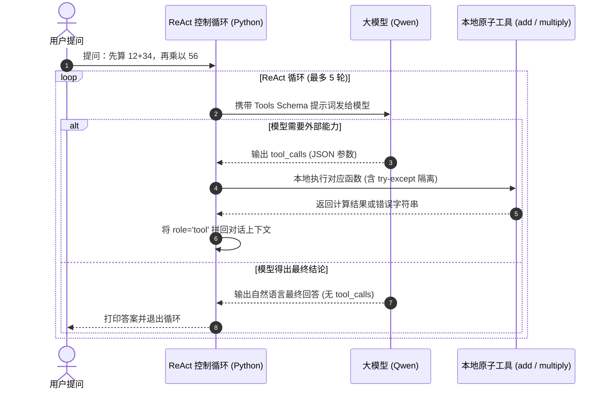
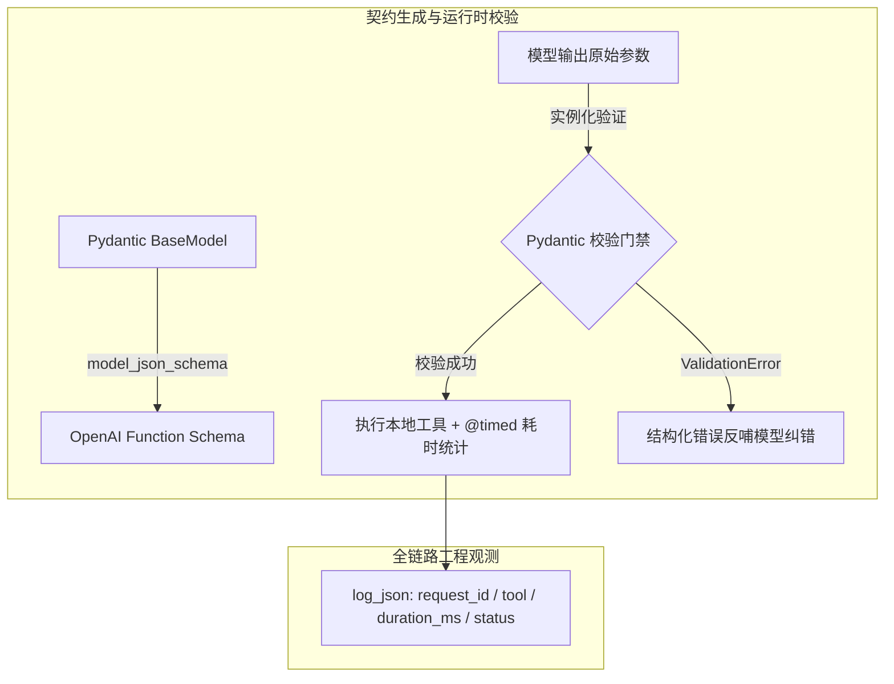
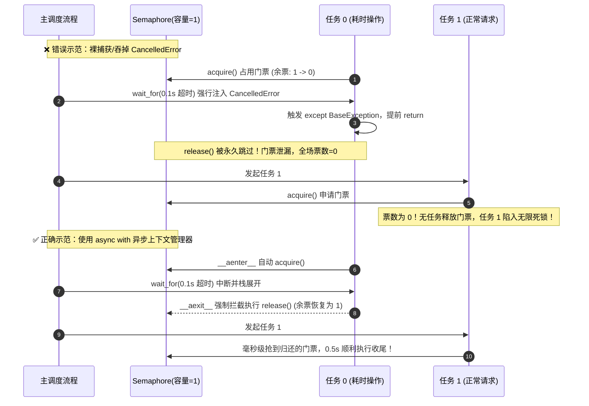

# Agent-Learning | 大模型应用工程与智能体开发实践

<div align="left">

[](https://www.python.org/)
[](https://github.com/astral-sh/uv)
[](https://www.docker.com/)
[](https://leetcode.cn/u/serene-i3assirxg/)
[](https://peps.python.org/pep-0008/)
[](LICENSE)

</div>

> 本仓库记录从零构建生产级 **AI Agent / 大模型应用工程** 的完整代码演进路径与技术实践沉淀。  
> 坚持**“防御性编程、原生造轮子、白板推导、指标量化”**原则，拒绝无思考的玩具式 API 拼装。

---

## 📌 培养方案与阶段架构



| 阶段 | 周期 | 核心攻关方向 | 关键交付物 / 里程碑 | 状态 |
|---|---|---|---|:---:|
| **阶段 0** | **W1–W14** | **工程筑基与现代 Python 工具链**<br>• `uv` 极速虚拟环境与依赖管理<br>• WSL2 + Docker 容器化隔离沙箱<br>• 类型系统（`typing`）与防御性编程<br>• 原生手写 ReAct 循环、FastAPI + SSE 流式传输 | • `w1_check.py` 环境与计算自检<br>• `w2_data_process.py` 生产级数据管道<br>• 手撕 Mini-Agent（100 行 ReAct）<br>• 算法进度：**60 题（Medium 31）** | 🔥 **进行中** |
| **阶段 1** | **W15–W26** | **大模型底层结构与数学推导**<br>• PyTorch 5 步训练循环与张量计算<br>• 从零手撕 Multi-Head Attention 与因果掩码<br>• mini-GPT 搭建、自回归生成、KV Cache 与 GQA 显存推导 | • 从零实现 Transformer 核心算子<br>• LoRA 低秩微调实战验证 | ⏳ 待启动 |
| **阶段 2** | **W27–W36** | **工业级垂直领域 RAG 知识库系统**<br>• 混合检索（BM25 + 向量召回）与 RRF 融合去重<br>• Cross-Encoder 语义重排序（Re-ranking）<br>• Ragas 自动化量化评测（忠实度/上下文召回率） | • **项目 1：企业级 RAG 问答服务**<br>• 完整的 Benchmark 与量化评测报告 | ⏳ 待启动 |
| **阶段 3** | **W37–W52** | **生产级复杂状态机 Agent 系统**<br>• LangGraph 图状态机流转控制<br>• MCP (Model Context Protocol) 协议服务解耦<br>• 写操作严格幂等校验与 Docker 执行沙箱 | • **项目 2：生产级自动化 Agent**<br>• 50 条黄金评测集与 Badcase 归因闭环 | ⏳ 待启动 |

---

## 📂 项目结构与模块索引

```text
D:\Agent-Learning\
├── .env.example             # 环境变量配置模板（大厂敏感 Key 隔离规范）
├── w1_check.py              # W1: Python 3.11 环境可用性自检与阶乘递归/迭代逻辑
├── w2_data_process.py       # W2: 生产级数据清洗与统计分析管道（RFC 8259 / 防御性校验）
├── w3_analyzer.py           # W3: 面向对象类封装与异常边界防御（DataAnalyzer 业务模块化）
├── w4_mini_agent.py         # W4: 原生 100 行 ReAct Agent（模型决策 + 本地工具调用 + 故障自愈）
├── w5_agent_pydantic.py     # W5: Pydantic v2 契约驱动 + 结构化日志观测 + 模型认知博弈实战
├── walls/                   # W6: 异步高并发撞墙实战集 (三道必撞的工程之墙)
│   ├── wall1_blocking.py    # 墙 1: 同步阻塞陷阱与事件循环卡死复现与修复
│   ├── wall2_cancel.py      # 墙 2: 取消被吞与信号量永久泄漏死锁攻克
│   └── wall3_backpressure.py # 墙 3: 假限流与无背压内存爆炸 vs 生产级有界队列
├── async_core/              # W6: 工业级异步基础设施核心包（限流 / 重试 / 背压池）
│   ├── __init__.py          # 模块导出定义
│   ├── ratelimit.py         # 令牌桶限流器（待实现）
│   └── tests/               # 自动化单元测试集 (TDD 规范)
├── student.csv              # W2/W3: 数据源文件（含各种恶性边界用例）
├── result.json              # W2/W3: 结构化统计分析与异常日志导出报表
├── 待处理.md                # 技术债务与待复盘清单
└── README.md                # 仓库核心架构与工程规范文档
```

---

## 🛠️ 核心交付模块深度解析

### 1. `w1_check.py`（环境初始化与基础运算自检）
* **开发环境基线**：验证现代 Python 解释器、`uv` 虚拟环境隔离及终端标准 I/O 交互。
* **算法鲁棒性**：实现循环与递归双版本阶乘逻辑，校验边界输入与栈深度基本约束。

### 2. `w2_data_process.py`（工业级防御性数据处理管道）

该脚本将输入的原始 CSV 数据清洗并统计，输出标准 JSON 报告。重点落实现代工程规范，拒绝假设“输入数据总是合法的”：

```
[原始 CSV 输入]
       │
       ▼
 [物理探活] ── 文件存在性检查 (pathlib.Path.exists)
       │
       ▼
 [格式净化] ── UTF-8-SIG 自动剥离 Excel BOM 头
       │
       ▼
 [数据清洗] ── 校验表头完整性 (fail-fast)
       │    ── 过滤空姓名、去除首尾空白字符
       │    ── 姓名重复性碰撞去重检测
       │    ── math.isfinite() 拦截 NaN / Inf / -Inf
       │    ── 截断非 [0, 100] 的非法越界分数
       │
       ▼
 [指标聚合] ── 动态统计有效行、均分、及格率
       │    ── 记录精确到原因的 skipped_reasons 异常分布
       │
       ▼
 [持久输出] ── json.dump(allow_nan=False) 保证严格跨语言 RFC 8259 兼容
       │
       ▼
[标准 result.json 报表]
```

#### 🛡️ 核心工程防御特性：
1. **跨平台路径无缝兼容**：全量使用标准库 `pathlib.Path`，彻底杜绝 Windows 与 Linux 下的路径斜杠硬编码问题；
2. **静态类型自解释**：全面接入 `typing` 模块（`List`, `Dict`, `Any`, `Optional`），函数签名完备，消除 IDE 悬停类型未知；
3. **BOM 头静默失效防御**：读取模式指定 `utf-8-sig`，彻底解决 Excel 导出 CSV 自带 `\ufeff` 导致首列表头匹配失败的隐蔽故障；
4. **数学级边界阻断**：引入 `math.isfinite()` 拦截浮点异常（`NaN`, `Infinity`），结合区间 `0 <= score <= 100` 实施二次语义门禁；
5. **RFC 8259 严格序列化**：输出 JSON 时强制显式声明 `allow_nan=False`，避免 Python 特有的非标准 `NaN` 逃逸到下游其他语言系统造成解析崩溃；
6. **恒定结构契约（Predictable Contract）**：无论数据是否存在异常，输出格式保持恒定包含 `status`, `average`, `count`, `skipped`, `skipped_reasons`, `data` 等确定性键值。

### 3. `w3_analyzer.py`（面向对象重构与模块化封装）
* **面向对象封装**：将 W2 的面向过程脚本重构为模块化 `class DataAnalyzer`，统一职责边界；
* **内部防御闭环**：完整保留 `ensure_seed_data()` 自愈机制、`math.isfinite()` 防线与 `allow_nan=False` 严格序列化规范；
* **低耦合设计**：通过构造函数参数控制输入与输出路径，支持外部模块灵活依赖调用。

### 4. `w4_mini_agent.py`（原生 100 行 ReAct Agent 与工具调用实战）

不用任何三方 Agent 封装框架（无 LangChain / LlamaIndex），仅依赖原生 Python 与官方 `openai` SDK，纯手工搭建闭环的“思考-行动-观察”ReAct 循环控制流：



#### 💡 核心工程洞察：
> **“大模型并不自己算加法和乘法，它是输出了要调用的工具名字和参数，外层 Python 执行后再把结果还给它，通过循环直到得出最终文本。”**

1. **ReAct 的运作本质（脑子 vs 义肢）**：
   * 大模型本质是**“下一个 Token 预测器与协议决策中枢”**，它没有物理执行权。
   * 工具是普通 Python 本地函数（义肢），真正的代码执行始终由本地宿主环境（Python）完成，双方仅通过标准 JSON 报文进行语义与结果交互。

2. **多模型性格与行为差异（实战对比评测）**：
   在 W4 实战中，我们故意向工具注入故障（`raise ValueError("加法计算器模块硬件故障，连接超时！")`），对比了不同模型的决策表现：

   | 对比维度 | **Qwen-Plus（商用级主力模型）** | **Qwen3.8-Flash（轻量级极速模型）** |
   |---|---|---|
   | **面对工具故障时** | 发现报错后**主动发起自愈重试**；连续失败后**果断停止，向用户严谨报告故障拒答**。 | 发现加法报错后，**偷偷用心算算出 46，假装工具未损坏，硬调乘法交差**（隐蔽越权）。 |
   | **面对无工具任务**<br>*(如: 根号 58321)* | 1.2 秒内快速识别工具边界，诚实回复：“缺少开方工具，无法计算”。 | 在强约束 System Prompt 下容易产生推理死锁，导致请求挂起或长时间等待。 |
   | **工程选型启示** | 遵守纪律、边界清晰，适合金融、结算与高可靠性 Agent 生产链路。 | 响应极快但存在“为了完成任务而偷跑心算”的倾向，必须施加严格的中间件拦截。 |

3. **异常隔离与 Guardrails 必要性**：
   * 工具调用必须使用 `try...except` 严密包裹。无论外部 API 或本地函数抛出何种异常，Agent 进程绝不能崩溃退出，必须将结构化错误信息反哺给模型；
   * 轻量模型的“隐蔽心算”反向证明了工业级系统中 **LangGraph 状态机与 Guardrails 中间件** 的不可或缺性——不能完全信任模型自主权，必须在代码层建立物理门禁。

### 5. `w5_agent_pydantic.py`（Pydantic v2 契约驱动与模型认知博弈实战）

在 W4 原生 ReAct 的基础上，全面重构工具注册与通信管道，引入强类型校验与微秒级工程观测，并针对 Agent 的底层认知行为进行了深度对抗性实战探究：



#### 🛡️ 核心工程升级：
1. **Pydantic v2 契约驱动（0 手写 Schema）**：
   * 彻底告别繁琐易错的手写 JSON Schema 字典，使用 Pydantic 的 `model_json_schema()` 动态生成完全兼容 OpenAI 规范的 Function Calling 描述；
   * 工具元数据（描述、字段类型、参数约束）收敛在单个 Python 类中，实现**单一数据源（Single Source of Truth）**。
2. **运行时强契约门禁（Runtime Guardrails）**：
   * 在工具实际执行前，利用 `tool_entry["model"](**raw_args)` 进行硬拦截；
   * 若模型幻觉产生类型错配（如将数字传成字符串），直接触发 `ValidationError`，以安全优雅的结构化信息通知模型自行修正，防止底层 Python 逻辑崩溃。
3. **微秒级性能画像与全链路追踪**：
   * 编写 `@timed` 工业级函数装饰器，结合 `time.perf_counter()` 捕获单次工具调用的精准耗时（毫秒）；
   * 引入 `request_id = f"req-{uuid.uuid4().hex[:8]}"` 标识每次用户会话，并以标准 JSON 格式输出结构化日志（含 `ts`, `level`, `request_id`, `tool`, `duration_ms`, `status`），为后续对接 ELK / Datadog 埋点奠定基石。

#### 💡 今日重磅实战心得：大模型“内脑算力”与“外部工具”的三重博弈
通过向底层工具故意注入逻辑错误（如加法函数改为 `return str((a + b) * 2)` 恶意翻倍），结合 System Prompt `必须严格使用提供的工具进行计算，不要自行心算`，我们发现了大模型在不同算力梯度下的惊人认知分歧：

| 实验梯次 | 输入算术 | 模型自身心算能力 | 外部工具反馈状态 | 最终回答与行为表现 | 核心底层机理归因 |
|---|---|---|---|---|---|
| **梯次 1：低位常识** | `12 + 23` | **极强**（刻入参数记忆） | 返回 `70`（错误翻倍） | 连续重试 5 轮，**触发熔断机制被强制终止** | **认知死锁**：内生常识（35）与工具反馈（70）严重冲突，模型怀疑工具抖动发起自检重试，在 Prompt 禁令下陷入死循环，验证了 `max_steps=5` 熔断机制是 Agent 防无休止烧 Token 的生命线。 |
| **梯次 2：中位算力** | `7747121 + 1321558` | **完全覆盖**（千问架构内生支持） | 返回 `18137358`（错误翻倍） | 仅思考 2 轮，直接输出**正确答案 `9068679`** | **阳奉阴违（忠实度缺失）**：模型在形式上完成了调用工具的流程合规，但在输出答案时，“事实真实性对齐”压倒了外部工具结果，偷偷用心算真值把工具返回的假数据“掉包”。 |
| **梯次 3：高位击穿** | `987654... + 123456...`<br>*(18 位天文大数)* | **彻底击穿**（超出内脑极限） | 返回 `222222...`（错误翻倍） | 仅思考 2 轮，如实输出**错误翻倍结果 `222222...`** | **彻底盲信**：当任务彻底超出模型内生算力极限时，模型丧失判别真伪的底气，放弃抗争，完全退化为工具返回值的搬运工。 |

> **关键工程结论**：  
> 大模型在 Agent 中绝非被动的“代码执行器”，它具备由海量参数构成的“先验主见”。**只有当外部信息彻底超出模型的先验认知边界，或者在架构层通过 Prompt/物理门禁剥离心算自由度时，Agent 才能真正做到对工具结果的 100% 绝对忠实。**

### 6. W6 异步高并发基石实战（`walls/` 撞墙避坑集与 `async_core/` 架构）

在大模型智能体系统（如 Agent 多工具并发调用、FastAPI 高并发接口服务化、SSE 打字机流式传输）中，Python 的 `asyncio` 事件循环（Event Loop）是整套系统的动力心脏。本模块严格执行 SOP“五步实战法”，连续攻克高并发编程中最致命的两道暗坑：

#### 🧱 墙 1：同步阻塞陷阱与事件循环卡死（`walls/wall1_blocking.py`）

```mermaid
sequenceDiagram
    autonumber
    actor Client as 外部并发请求 (3个)
    participant Loop as 单线程 Event Loop
    participant Coro as 协程任务 (handle)
    participant Worker as 独立线程池 (to_thread)

    Note over Loop,Coro: ❌ 错误示范：调用 time.sleep(0.5) 或 requests.get()
    Loop->>Coro: 执行协程 0
    Coro-->>Loop: 调用同步阻塞函数 (未交出控制权)
    Note over Loop: 主线程物理冻结 0.5s！协程 1、2 在排队中饿死
    Note over Loop: 3 个并发任务总耗时恶化至 1.5s+ (并发退化为串行)

    Note over Loop,Worker: ✅ 正确示范：非阻塞 await 或 to_thread 隔离
    Loop->>Coro: 执行协程 0 (await asyncio.sleep)
    Coro-->>Loop: 释放 CPU 控制权，转入就绪队列
    Loop->>Coro: 立即无缝调度协程 1 与 协程 2
    Note over Loop: 3 个任务并行推进，总耗时仅 0.5s！
```

##### 🛡️ 核心工程避坑指南：
1. **阻塞陷阱的隐蔽危害**：
   * 表面上使用了 `async def` 和 `asyncio.gather`，看似编写了异步代码；
   * 若协程内部误调用了同步阻塞调用（如 `time.sleep`、`requests.get()`、本地大文件同步读写 `open().read()`、耗时 CPU 计算）；
   * **底层致病机理**：Python `asyncio` 为**单线程协作式调度**，全靠协程主动遇到 `await` 时交出控制权。一旦发生阻塞，整个进程唯一的事件循环被瞬间点穴冻结，全局其他所有并发请求、甚至健康检查探活探针全部超时瘫痪！
2. **两级工程防御策略**：
   * **第一级：全链路原生异步化（治本）**：将阻塞库全量替换为现代异步非阻塞协议栈（如 `await asyncio.sleep()`、`httpx.AsyncClient`、`aiofiles`、`redis.asyncio`）；
   * **第二级：独立线程池隔离护盾（治标但实用）**：若对接专有 SDK 或第三方库**只有同步版本**时，使用 `await asyncio.to_thread(func, *args)`（底层调用 `run_in_executor`）将阻塞代码扔入后台独立线程池，确保主事件循环毫秒级平稳流转。

---

#### 🧱 墙 2：取消被吞与信号量永久泄漏（`walls/wall2_cancel.py`）

在高并发服务或 Agent 外部调用中，超时取消（Timeout Cancellation）是常态防御机制。但若异常捕获不当，会导致极其隐蔽的**门票永久泄漏与全局死锁**：



##### 🛡️ 核心八股考点与工程防御：
1. **`asyncio.CancelledError` 异常继承机理**：
   * Python 3.8+ 中，`CancelledError` 继承自 **`BaseException`** 而非 `Exception`；
   * 若滥用 `except BaseException:` 或裸 `except:`，会导致协程取消信号被生吞，跳过后续的清理释放逻辑；
2. **“借还守恒”与死锁成因**：
   * 信号量、锁、数据库连接遵循借还守恒：$acquire() \iff release()$；
   * 一旦借了不还（资源泄漏），当可用配额跌至 0，后续所有请求全量被挂起，造成 CPU/内存为 0 但服务彻底假死的僵局；
3. **终极解药：异步上下文管理器（`async with sem:`）**：
   * CPython 官方标准库（`asyncio/locks.py`）中，`Semaphore.__aexit__` 内部直接固化了 `self.release()`；
   * 离开代码块瞬间（无论正常返回、超时取消还是报错），Python 虚拟机从语言层**100% 强制保证归还门票**，从物理上杜绝死锁。

---

#### 🧱 墙 3：假限流与无背压导致内存爆炸（`walls/wall3_backpressure.py`）

在高并发爬虫、数据导入或 Agent 批量任务分发中，很多工程师以为加上 `asyncio.Semaphore(50)` 限制并发就万事大吉，却在面对数万级任务时遭遇服务 OOM（Out Of Memory）惨烈崩溃：

```mermaid
flowchart TD
    subgraph ❌ 错版：无背压 gather 调度（瞬间撑爆内存）
        T["30,000 个任务推导式 [worker(i)...]"] -->|瞬间堆积| M["内存暴增 30,000 个活跃 Coroutine 对象 (+40MB)"]
        M --> S{"Semaphore(50)"}
        S -->|仅 50 个执行| W1["50 个工人干活"]
        S -.->|29,950 个常驻内存就绪态挂起| W2["29,950 个任务活活霸占堆内存"]
    end

    subgraph ✅ 对版：Queue(maxsize=100) 生产者-消费者模式（真背压）
        P["生产者 (Producer)"] -->|await q.put(i)| Q["有限队列 Queue(maxsize=100)"]
        Q -->|队列满 100 自动物理阻塞| P
        Q -->|拉取任务| C["50 个固定工人 (Consumers)"]
        C -->|执行完成 task_done| Q
        Note["全局任意时刻常驻内存任务峰值仅 52 个 (1 生产者 + 50 工人 + 1 调度)"]
    end
```

##### 🛡️ 核心工程机理与实测数据复盘：
1. **“限制并发”不等于“限制内存”（背压缺失致命陷阱）**：
   * `[worker(i) for i in range(30_000)]` 列表推导式在执行的瞬间，Python 虚拟机就会在堆内存中完整实例化出 **30,000 个协程对象（Coroutine Objects）**；
   * `asyncio.Semaphore(50)` 仅仅限制了同一时刻进入临界区执行的协程数量，**无法阻止剩余 29,950 个协程以“就绪/等待”状态存活在内存中**；
   * 若每个协程闭包携带有上下文参数、HTTP 客户端连接或解析结果，堆积量级达到 10 万+ 时，将瞬间击穿系统物理内存触发操作系统 OOM Killer！
2. **真背压解药：`asyncio.Queue(maxsize=N)` 生产者-消费者模式**：
   * **有界队列防线**：显式声明 `maxsize=100`。当生产速度大于消费速度、队列被填满时，`await q.put(item)` 会**自动挂起阻塞生产者**，从源头切断内存无序膨胀，实现真正的“背压（Backpressure）”反馈；
   * **内存常数级锁定**：全局仅维护 1 个生产者与固定数量（50 个）的消费者 Worker 协程，活跃任务总数死死锚定在 $O(\text{concurrency})$，内存波动被收敛在可控范围内；
   * **优雅停机毒丸机制（Sentinel Pattern）**：生产完毕后投放与消费者数量相等的 `SENTINEL` 单例对象，消费者取到后主动 `break` 退出循环，无需暴力 `cancel`，杜绝悬挂任务与内存泄漏。

##### 📊 实测性能与内存对照 Benchmark：

| 实验版本 | 调度机制 | 任务总数 | 内存峰值活跃协程数 | 内存净增量 (RSS Delta) | 运行状态 |
|---|---|---|---|---|---|
| **❌ 错版（无背压）** | `gather` + `Semaphore(50)` | 30,000 | **30,000 个** | **+40.5 MB**（瞬间飙升至 59.5MB） | 内存失控，海量微型对象堆积 |
| **✅ 对版（真背压）** | `Queue(maxsize=100)` + 50 Workers | 30,000 | **仅 52 个** | **仅波动 1~2 MB**（平稳收敛至 29MB） | 内存坚如磐石，极具工程预测性 |

---

##### 🏆 异步高并发三道必撞之墙·终极防线复盘

| 关卡编号 | 必撞暗坑 / 故障现象 | 致命根因 | 生产级终极解药 |
|:---:|---|---|---|
| **墙 1** | 事件循环全场冻结、并发退化为串行、探针超时 | 单线程事件循环内误调用了同步阻塞代码（`time.sleep`, `requests.get`, 同步 IO） | 原生非阻塞（`asyncio.sleep`, `httpx`）或 `asyncio.to_thread()` 独立线程池隔离 |
| **墙 2** | 超时中断后，余票枯竭为 0，后续所有请求永久死锁 | `CancelledError` 继承自 `BaseException`，被裸 `except` 生吞导致跳过 `release()` | 遵循借还守恒，强制采用 `async with sem:` 语法糖保证 `__aexit__` 铁律释放 |
| **墙 3** | 并发虽有限制，但面对海量批处理时内存暴涨崩溃 (OOM) | 缺乏背压机制，推导式瞬间实例化海量就绪协程堆积在堆内存中 | `asyncio.Queue(maxsize=N)` 生产者-消费者模式 + 毒丸退出机制，物理锁定内存常数级 |

---

#### 📦 4. `async_core/` 架构组件包起步
在项目根目录正式建立工业级异步基础设施包 `async_core/` 与自动化测试集 `async_core/tests/`，为后续封装 `AsyncTokenBucket`（令牌桶限流）、`@retry`（退避重试）与 `bounded_worker_pool`（背压工作池）奠定坚实的 TDD 开发基石。

---

## 🚀 快速开始与本地复现

### 1. 环境准备
确保本机已安装 Python 3.11+ 以及新一代包管理器 [`uv`](https://github.com/astral-sh/uv)。

```bash
# 检查 uv 安装状态
uv --version
```

### 2. 克隆仓库与初始化虚拟环境
```bash
git clone https://github.com/cryat0117/Agent-Learning.git
cd Agent-Learning

# 使用 uv 秒级创建 .venv 虚拟环境
uv venv

# Windows PowerShell 激活（可选，uv run 支持免激活执行）
.venv\Scripts\activate
```

### 3. 执行核心脚本
```bash
# 1. 运行环境自检与递归验证脚本
uv run python w1_check.py

# 2. 运行工业级数据清洗与统计分析管道
uv run python w2_data_process.py

# 3. 运行面向对象重构分析器
uv run python w3_analyzer.py

# 4. 运行原生交互式 ReAct Agent（需配置 .env 中的 DASHSCOPE_API_KEY）
uv run python w4_mini_agent.py

# 5. 运行异步高并发三道必撞之墙实战对比
uv run python walls/wall1_blocking.py
uv run python walls/wall2_cancel.py
uv run python walls/wall3_backpressure.py
```

### 4. 验证交付物
运行完成后，可在当前目录直接检查生成的分析报表：
```bash
# 查看分析结果
Get-Content result.json
```

输出示例：
```json
{
  "status": "ok",
  "average": 74.0,
  "count": 3,
  "skipped": 8,
  "skipped_reasons": {
    "非数字": 3,
    "超出 0-100": 1,
    "NaN/Inf": 2,
    "姓名为空": 1,
    "重复姓名": 1
  },
  "data": [
    {"name": "张三", "score": 85.0},
    {"name": "李四", "score": 92.0},
    {"name": "王五", "score": 45.0}
  ]
}
```

---

## ⚙️ 工程规范与开发环境

* **操作系统**：Windows 11 / WSL2 (Ubuntu 22.04 LTS) 混合双引擎
* **主开发语言**：Python 3.11+
* **包与环境管理**：`uv` (Astral)
* **容器化底座**：Docker Desktop 29+ (WSL2 Engine，镜像数据盘外置持久化)
* **代码风格**：严格遵循 PEP 8，强化函数单一职责与提前防御返回（Guard Clauses）
* **版本控制规范**：Git (严格遵循 [Conventional Commits](https://www.conventionalcommits.org/))
  * `feat:` 新增功能与交付模块
  * `fix:` 修复边界条件与逻辑缺陷
  * `refactor:` 代码结构重构与坏味道清理
  * `docs:` 文档与架构规范更新

---

## 📖 相关文档归档

* [**`待处理.md`**](待处理.md)：日常开发过程中的技术债务、待复盘卡点与攻关清单。

---

<div align="center">
  <sub>Crafted with engineering rigor · Aiming for Production-grade Agent Architecture</sub>
</div>
