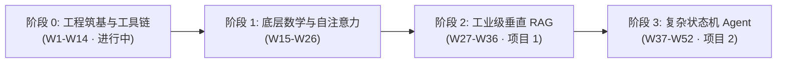
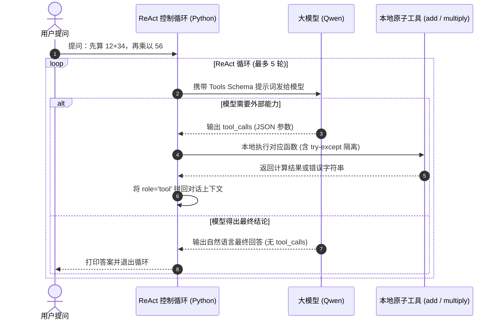

# Agent-Learning | 大模型应用工程与智能体开发实践

<div align="left">

[](https://www.python.org/)
[](https://github.com/astral-sh/uv)
[](https://www.docker.com/)
[](https://leetcode.cn/u/serene-i3assirxg/)
[](https://peps.python.org/pep-0008/)
[](LICENSE)

</div>

> 本仓库记录从零构建生产级 **AI Agent / 大模型应用工程** 的完整代码演进路径与技术实践沉淀。  
> 坚持**“防御性编程、原生造轮子、白板推导、指标量化”**原则，拒绝无思考的玩具式 API 拼装。

---

## 📌 培养方案与阶段架构



| 阶段 | 周期 | 核心攻关方向 | 关键交付物 / 里程碑 | 状态 |
|---|---|---|---|:---:|
| **阶段 0** | **W1–W14** | **工程筑基与现代 Python 工具链**<br>• `uv` 极速虚拟环境与依赖管理<br>• WSL2 + Docker 容器化隔离沙箱<br>• 类型系统（`typing`）与防御性编程<br>• 原生手写 ReAct 循环、FastAPI + SSE 流式传输 | • `w1_check.py` 环境与计算自检<br>• `w2_data_process.py` 生产级数据管道<br>• 手撕 Mini-Agent（100 行 ReAct）<br>• 算法进度：**60 题（Medium 31）** | 🔥 **进行中** |
| **阶段 1** | **W15–W26** | **大模型底层结构与数学推导**<br>• PyTorch 5 步训练循环与张量计算<br>• 从零手撕 Multi-Head Attention 与因果掩码<br>• mini-GPT 搭建、自回归生成、KV Cache 与 GQA 显存推导 | • 从零实现 Transformer 核心算子<br>• LoRA 低秩微调实战验证 | ⏳ 待启动 |
| **阶段 2** | **W27–W36** | **工业级垂直领域 RAG 知识库系统**<br>• 混合检索（BM25 + 向量召回）与 RRF 融合去重<br>• Cross-Encoder 语义重排序（Re-ranking）<br>• Ragas 自动化量化评测（忠实度/上下文召回率） | • **项目 1：企业级 RAG 问答服务**<br>• 完整的 Benchmark 与量化评测报告 | ⏳ 待启动 |
| **阶段 3** | **W37–W52** | **生产级复杂状态机 Agent 系统**<br>• LangGraph 图状态机流转控制<br>• MCP (Model Context Protocol) 协议服务解耦<br>• 写操作严格幂等校验与 Docker 执行沙箱 | • **项目 2：生产级自动化 Agent**<br>• 50 条黄金评测集与 Badcase 归因闭环 | ⏳ 待启动 |

---

## 📂 项目结构与模块索引

```text
D:\Agent-Learning\
├── .env.example             # 环境变量配置模板（大厂敏感 Key 隔离规范）
├── w1_check.py              # W1: Python 3.11 环境可用性自检与阶乘递归/迭代逻辑
├── w2_data_process.py       # W2: 生产级数据清洗与统计分析管道（RFC 8259 / 防御性校验）
├── w3_analyzer.py           # W3: 面向对象类封装与异常边界防御（DataAnalyzer 业务模块化）
├── w4_mini_agent.py         # W4: 原生 100 行 ReAct Agent（模型决策 + 本地工具调用 + 故障自愈）
├── student.csv              # W2/W3: 数据源文件（含各种恶性边界用例）
├── result.json              # W2/W3: 结构化统计分析与异常日志导出报表
├── 待处理.md                # 技术债务与待复盘清单
└── README.md                # 仓库核心架构与工程规范文档
```

---

## 🛠️ 核心交付模块深度解析

### 1. `w1_check.py`（环境初始化与基础运算自检）
* **开发环境基线**：验证现代 Python 解释器、`uv` 虚拟环境隔离及终端标准 I/O 交互。
* **算法鲁棒性**：实现循环与递归双版本阶乘逻辑，校验边界输入与栈深度基本约束。

### 2. `w2_data_process.py`（工业级防御性数据处理管道）

该脚本将输入的原始 CSV 数据清洗并统计，输出标准 JSON 报告。重点落实现代工程规范，拒绝假设“输入数据总是合法的”：

```
[原始 CSV 输入]
       │
       ▼
 [物理探活] ── 文件存在性检查 (pathlib.Path.exists)
       │
       ▼
 [格式净化] ── UTF-8-SIG 自动剥离 Excel BOM 头
       │
       ▼
 [数据清洗] ── 校验表头完整性 (fail-fast)
       │    ── 过滤空姓名、去除首尾空白字符
       │    ── 姓名重复性碰撞去重检测
       │    ── math.isfinite() 拦截 NaN / Inf / -Inf
       │    ── 截断非 [0, 100] 的非法越界分数
       │
       ▼
 [指标聚合] ── 动态统计有效行、均分、及格率
       │    ── 记录精确到原因的 skipped_reasons 异常分布
       │
       ▼
 [持久输出] ── json.dump(allow_nan=False) 保证严格跨语言 RFC 8259 兼容
       │
       ▼
[标准 result.json 报表]
```

#### 🛡️ 核心工程防御特性：
1. **跨平台路径无缝兼容**：全量使用标准库 `pathlib.Path`，彻底杜绝 Windows 与 Linux 下的路径斜杠硬编码问题；
2. **静态类型自解释**：全面接入 `typing` 模块（`List`, `Dict`, `Any`, `Optional`），函数签名完备，消除 IDE 悬停类型未知；
3. **BOM 头静默失效防御**：读取模式指定 `utf-8-sig`，彻底解决 Excel 导出 CSV 自带 `\ufeff` 导致首列表头匹配失败的隐蔽故障；
4. **数学级边界阻断**：引入 `math.isfinite()` 拦截浮点异常（`NaN`, `Infinity`），结合区间 `0 <= score <= 100` 实施二次语义门禁；
5. **RFC 8259 严格序列化**：输出 JSON 时强制显式声明 `allow_nan=False`，避免 Python 特有的非标准 `NaN` 逃逸到下游其他语言系统造成解析崩溃；
6. **恒定结构契约（Predictable Contract）**：无论数据是否存在异常，输出格式保持恒定包含 `status`, `average`, `count`, `skipped`, `skipped_reasons`, `data` 等确定性键值。

### 3. `w3_analyzer.py`（面向对象重构与模块化封装）
* **面向对象封装**：将 W2 的面向过程脚本重构为模块化 `class DataAnalyzer`，统一职责边界；
* **内部防御闭环**：完整保留 `ensure_seed_data()` 自愈机制、`math.isfinite()` 防线与 `allow_nan=False` 严格序列化规范；
* **低耦合设计**：通过构造函数参数控制输入与输出路径，支持外部模块灵活依赖调用。

### 4. `w4_mini_agent.py`（原生 100 行 ReAct Agent 与工具调用实战）

不用任何三方 Agent 封装框架（无 LangChain / LlamaIndex），仅依赖原生 Python 与官方 `openai` SDK，纯手工搭建闭环的“思考-行动-观察”ReAct 循环控制流：



#### 💡 核心工程洞察：
> **“大模型并不自己算加法和乘法，它是输出了要调用的工具名字和参数，外层 Python 执行后再把结果还给它，通过循环直到得出最终文本。”**

1. **ReAct 的运作本质（脑子 vs 义肢）**：
   * 大模型本质是**“下一个 Token 预测器与协议决策中枢”**，它没有物理执行权。
   * 工具是普通 Python 本地函数（义肢），真正的代码执行始终由本地宿主环境（Python）完成，双方仅通过标准 JSON 报文进行语义与结果交互。

2. **多模型性格与行为差异（实战对比评测）**：
   在 W4 实战中，我们故意向工具注入故障（`raise ValueError("加法计算器模块硬件故障，连接超时！")`），对比了不同模型的决策表现：

   | 对比维度 | **Qwen-Plus（商用级主力模型）** | **Qwen3.8-Flash（轻量级极速模型）** |
   |---|---|---|
   | **面对工具故障时** | 发现报错后**主动发起自愈重试**；连续失败后**果断停止，向用户严谨报告故障拒答**。 | 发现加法报错后，**偷偷用心算算出 46，假装工具未损坏，硬调乘法交差**（隐蔽越权）。 |
   | **面对无工具任务**<br>*(如: 根号 58321)* | 1.2 秒内快速识别工具边界，诚实回复：“缺少开方工具，无法计算”。 | 在强约束 System Prompt 下容易产生推理死锁，导致请求挂起或长时间等待。 |
   | **工程选型启示** | 遵守纪律、边界清晰，适合金融、结算与高可靠性 Agent 生产链路。 | 响应极快但存在“为了完成任务而偷跑心算”的倾向，必须施加严格的中间件拦截。 |

3. **异常隔离与 Guardrails 必要性**：
   * 工具调用必须使用 `try...except` 严密包裹。无论外部 API 或本地函数抛出何种异常，Agent 进程绝不能崩溃退出，必须将结构化错误信息反哺给模型；
   * 轻量模型的“隐蔽心算”反向证明了工业级系统中 **LangGraph 状态机与 Guardrails 中间件** 的不可或缺性——不能完全信任模型自主权，必须在代码层建立物理门禁。

---

## 🚀 快速开始与本地复现

### 1. 环境准备
确保本机已安装 Python 3.11+ 以及新一代包管理器 [`uv`](https://github.com/astral-sh/uv)。

```bash
# 检查 uv 安装状态
uv --version
```

### 2. 克隆仓库与初始化虚拟环境
```bash
git clone https://github.com/cryat0117/Agent-Learning.git
cd Agent-Learning

# 使用 uv 秒级创建 .venv 虚拟环境
uv venv

# Windows PowerShell 激活（可选，uv run 支持免激活执行）
.venv\Scripts\activate
```

### 3. 执行核心脚本
```bash
# 1. 运行环境自检与递归验证脚本
uv run python w1_check.py

# 2. 运行工业级数据清洗与统计分析管道
uv run python w2_data_process.py

# 3. 运行面向对象重构分析器
uv run python w3_analyzer.py

# 4. 运行原生交互式 ReAct Agent（需配置 .env 中的 DASHSCOPE_API_KEY）
uv run python w4_mini_agent.py
```

### 4. 验证交付物
运行完成后，可在当前目录直接检查生成的分析报表：
```bash
# 查看分析结果
Get-Content result.json
```

输出示例：
```json
{
  "status": "ok",
  "average": 74.0,
  "count": 3,
  "skipped": 8,
  "skipped_reasons": {
    "非数字": 3,
    "超出 0-100": 1,
    "NaN/Inf": 2,
    "姓名为空": 1,
    "重复姓名": 1
  },
  "data": [
    {"name": "张三", "score": 85.0},
    {"name": "李四", "score": 92.0},
    {"name": "王五", "score": 45.0}
  ]
}
```

---

## ⚙️ 工程规范与开发环境

* **操作系统**：Windows 11 / WSL2 (Ubuntu 22.04 LTS) 混合双引擎
* **主开发语言**：Python 3.11+
* **包与环境管理**：`uv` (Astral)
* **容器化底座**：Docker Desktop 29+ (WSL2 Engine，镜像数据盘外置持久化)
* **代码风格**：严格遵循 PEP 8，强化函数单一职责与提前防御返回（Guard Clauses）
* **版本控制规范**：Git (严格遵循 [Conventional Commits](https://www.conventionalcommits.org/))
  * `feat:` 新增功能与交付模块
  * `fix:` 修复边界条件与逻辑缺陷
  * `refactor:` 代码结构重构与坏味道清理
  * `docs:` 文档与架构规范更新

---

## 📖 相关文档归档

* [**`待处理.md`**](待处理.md)：日常开发过程中的技术债务、待复盘卡点与攻关清单。

---

<div align="center">
  <sub>Crafted with engineering rigor · Aiming for Production-grade Agent Architecture</sub>
</div>
